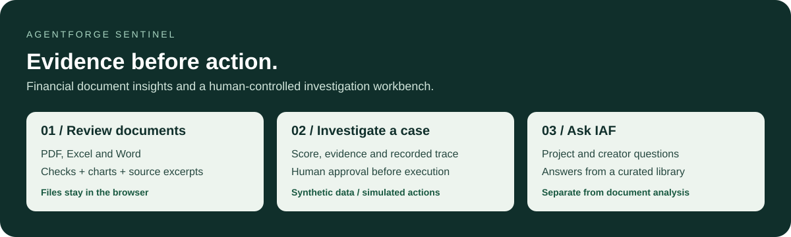
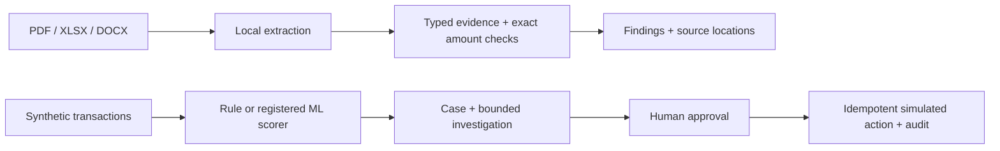

# AgentForge Sentinel

**Understand financial discrepancies. Follow the evidence. Keep people in control.**

Sentinel is a financial investigation project built by **Phaneendra Gavara**.
It helps you compare financial documents, investigate synthetic transactions,
and understand why a finding deserves review. Every case action is simulated.

[**Try the website**](https://agentforge-sentinel.vercel.app/) ·
[Sample documents](https://agentforge-sentinel.vercel.app/examples.html) ·
[What it checks](https://agentforge-sentinel.vercel.app/capabilities.html) ·
[Project guide](docs/artifacts/AgentForge_Sentinel_Complete_Project_Study_Guide_2026-11-08.md)



## Try it in three minutes

1. Open the [invoice and delivery example](https://agentforge-sentinel.vercel.app/?sample=purchase#review) and select **Try the sample**.
2. Compare the invoice, order, delivery record and trusted vendor baseline. Open a finding's source to check the numbers yourself.
3. Open the [live workbench](https://agentforge-sentinel.vercel.app/workbench), start a synthetic case, investigate it, and explicitly approve before executing a simulated action.

Prefer an explanation first? Follow the [five-step case walkthrough](https://agentforge-sentinel.vercel.app/walkthrough.html).
[IAF](https://agentforge-sentinel.vercel.app/iaf.html), the project assistant, answers questions about Sentinel and its creator.

## What you get

| Experience | What it does | Where the data goes |
| --- | --- | --- |
| **Document insights** | Reads supported PDF, XLSX and DOCX layouts; reconciles balances and compares related invoices, orders, deliveries and payments. Shows source excerpts and charts. | Selected files and findings stay in browser memory. No document AI calls. |
| **Case workbench** | Scores synthetic transactions, records investigations, displays evidence and requires explicit approval before simulated execution. | Scoped synthetic records are stored by FastAPI and PostgreSQL. Public sessions expire after 30 minutes. |
| **IAF project assistant** | Retrieves curated explanations about the project and creator. Optional OpenAI passage selection chooses among approved answers. | Questions go to the server; only matched topic cues and public passages go to the optional model. Document review is separate. |
| **Local document worker** | Extracts public/synthetic CSV, XLSX and PDF files through the opt-in document API. | Files enter a local owned store. This is a separate setup from browser-only review. |

### A concrete example

An invoice bills **200 units at $120**, its purchase order agrees **$100 per unit**,
and its delivery record reports **150 units**. Sentinel can flag the **$20 unit-price
difference** and the **50-unit delivery gap**, then show the supporting records.
A changed payment destination can be compared with an independently trusted vendor baseline.

These are discrepancies to investigate. They do not establish fraudulent intent or
prove a document authentic. Missing fields and unsupported layouts can leave a check
**inconclusive** or **unavailable**, rather than passed.

## How it works



The document path and case path are separate. A document finding cannot approve an action.
The public workbench uses deterministic investigations and rule scoring. The local app
also supports a registered scikit-learn model and optional bounded investigator adapters.

| Layer | Implementation |
| --- | --- |
| UI | React, TypeScript and Vite workbench; static HTML/CSS/JavaScript public site |
| Browser extraction | PDF.js, bounded Office ZIP parsing, Web Workers, exact minor-unit arithmetic |
| Backend | Python, FastAPI, Pydantic, PostgreSQL, scoped bearer sessions and restricted runtime grants |
| Investigation | Recorded analyst/investigator/reviewer workflow, bounded calls, checked claims, recovery |
| ML | Frozen synthetic p1 protocol, chronological evaluation and registered histogram gradient boosting model |
| Delivery | Vercel combined static/API package; Neon for the synthetic hosted demo |

## Data, privacy and limits

- The published p1 snapshot contains **82,819 synthetic transactions across 600 fictional accounts**. [Dataset and provenance](https://agentforge-sentinel.vercel.app/dataset.html).
- The browser library has **24 synthetic sample files** plus two labeled U.S. Treasury reports. Normal controls accompany discrepancy examples. [Layouts and limits](docs/ui/PUBLIC-DOCUMENT-INSIGHTS.md).
- A public dataset acquired separately did **not** train p1. Synthetic performance does not establish real-world fraud accuracy.
- Browser review accepts up to 10 supported files, **10 MB per file and 20 MB combined**, with a 40-page PDF limit. Older `.doc` files need conversion to `.docx`; scanned PDFs need OCR that this release does not provide.
- Browser review keeps files in the tab. Local worker uploads use local storage. Synthetic workbench sessions expire, but their database records are not automatically erased at expiry.
- There are no bank connections, real payment execution, production Reports screen, or validated customer-scale capacity claims.

**Security review:** the [November 15 audit](docs/security/PROJECT-REVIEW-2026-11-15.md)
records dependency advisories, missing anti-framing headers and deployment hardening work.
This is a working research/portfolio demo; customer-document hosting needs additional controls.

## Run locally

**Just the public document reviewer** — no database or model key:

```powershell
python -m http.server 8080 --bind 127.0.0.1 --directory public_site/static
```

Open `http://127.0.0.1:8080`. Document samples and the recorded walkthrough work locally;
the IAF API and live case links use the hosted service.

**The full case workbench** — requires Python 3.11+, uv, Node 22+ and native PostgreSQL binaries:

```powershell
uv sync --locked --extra dev --extra ml
$env:SENTINEL_LIVE_CLAUDE = '0'
uv run --locked python scripts/local_stack.py up
uv run --locked python scripts/local_stack.py status
```

In another terminal, run `npm ci` and `npm run dev` inside `web/`. Open Vite's printed URL
and use the local token in `.agent/stack/session.json`; keep that file private.
From the project root, run `uv run --locked python scripts/local_stack.py smoke` to seed
and verify a synthetic case. Stop Vite with Ctrl+C and use
`uv run --locked python scripts/local_stack.py down` for verified stack shutdown.

The defaults need no model key. `up --scorer model` requires provisioned account profiles.
The local document worker requires its own locked environment and opt-in session grant.
[Setup](SETUP.md) · [Operator runbook](docs/runbooks/local-operations.md) ·
[Document worker setup](docs/security/DOC01-document-upload.md)

## Evidence and next steps

Verification is tied to named releases, not a continuously valid badge:

| Release | Recorded evidence |
| --- | --- |
| [AN01-M1 integration](docs/releases/AN01-M1-main-integration-2026-11-14.md) | 1,099 Windows / 1,103 Ubuntu backend passes, one allowed live-provider skip each |
| [Document Review UI](docs/releases/DOC01-Part-C-main-integration-2026-11-14.md) | 266 frontend tests and 41 Windows Chromium cases |
| [Browser insights](docs/releases/DOCUMENT-INSIGHTS-GITHUB.md) | 56 Node tests, file-to-browser checks, 22 typed assertions across 14 scenarios |

Next priorities are dependency updates, public-service hardening, reproducible release
packaging and wider document evaluation. Reporting measurement remains a prototype.
Scaling to real customer data comes after identity, isolation, retention and abuse controls.

| Read next | Purpose |
| --- | --- |
| [Security review](docs/security/PROJECT-REVIEW-2026-11-15.md) | Findings, evidence, priorities and verification limits |
| [Usage and scaling plan](docs/artifacts/SENTINEL-USAGE-AND-SCALING.md) | Practical demos, phased growth and useful metrics |
| [Resume, LinkedIn and profile guide](docs/artifacts/SENTINEL-PORTFOLIO.md) | Evidence-backed wording and a reusable personal-assistant profile |
| [Complete study guide](docs/artifacts/AgentForge_Sentinel_Complete_Project_Study_Guide_2026-11-08.md) | Full project idea and implementation history |
| [Start here](docs/START_HERE.md) | Durable context for a new contributor or assistant chat |

Owner: **Phaneendra Gavara / PHANI465**. Third-party code, public reports and model/data
provenance retain their source credits. Vercel publication uses the
[combined release procedure](hosting/vercel/README.md); a GitHub push alone does not deploy it.
