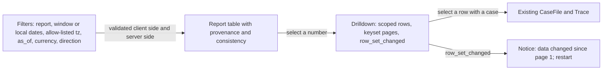

# AN01: financial analyst workspace design (revision r2)

Audience: Codex, as reviewer and later integrator, and the backend and frontend implementers of the first analyst slice. This is the analyst-depth part of roadmap milestone G2 ([PROJECT_PLAN](../PROJECT_PLAN.md) §G2). It does not rename or renumber G4.

- **Status:** design draft r2 for review. Nothing here is implemented, accepted or exposed. This revision is not Codex contract acceptance.
- **Draft markers:** every route, capability, error code, DTO, index, table, limit and CLI flag below is a **draft requiring review**.
- **Base:** the original draft `dd6518d` (r1), on main `d8443a1`, which contains tested integration `495c7d3`. Code facts were re-read from the source at that commit. The design does not depend on the unaccepted G3D-P4a branch.
- **Companion documents:**
  - [AN01-report-contract-draft.md](AN01-report-contract-draft.md): routes, filters, cursor, DTOs and calculation rules;
  - [AN01-acceptance-cases.md](AN01-acceptance-cases.md): the known-answer fixture, thought experiments and proposed (unrun) tests;
  - [check_an01.py](check_an01.py): a stdlib-only, no-I/O checker that recomputes the known answers.

## 0. What r2 changes, and why

The P4a/AN01 delivery intake (`docs/handoff/P4a-AN01-delivery-intake-2026-11-06.md` on main) and the AN01-r2 assignment raised seven issues. r2 resolves them as follows.

| # | Issue | r2 decision | Where |
| --- | --- | --- | --- |
| 1 | An `ingested_at <= as_of` filter does not make a snapshot across requests | **Honest per-request snapshots.** Each request is one `REPEATABLE READ, READ ONLY` transaction. Cross-request changes are disclosed, and for drilldown pages they are *detected* with a monotone count pair. No stability is claimed from `as_of`. A held snapshot is deferred | §5 |
| 2 | Time bases were mixed; R03 was counted as a case created inside the window | Separate bases: transaction event time, case creation, action completion and current workload age at `read_at`. Case state is always current; a past `as_of` is not history | §4 |
| 3 | The fixture claimed every row could be created through today's API | The fixture separates API requests from one labelled operator row (pre-0002, no outcome), and stated alerts now equal what rule r1 actually computes. Request and stored-row counts are kept apart | acceptance §1 |
| 4 | Money bounds, IANA day lengths and query bounds were overstated | Bounds re-verified in code. Day length is reported in seconds. S1 accepts a reviewed five-zone allow-list. Output rows, matching input rows, time and memory are bounded (or not) separately | §3, §6, §8 |
| 5 | Permission justified by "reveals nothing additional"; export auditing undecided | New opt-in capability `read_report`, issued only by the operator CLI, with no backfill. **CSV export is deferred from S1** to S2, with one explicit audit proposal | §7, §11 |
| 6 | `labels.availability` was both S1 and deferred; the cursor and streaming rules were loose | Labels are **deferred** everywhere. The cursor is bound to the report and its filters, with defined malformed/tampered behaviour. S2 export is fully buffered | §9, §11, contract §2 |
| 7 | The known answers were checked once and not committed | `check_an01.py` recomputes them, and the database/browser tests stay labelled unrun | acceptance §2–§4 |

## 1. What the analyst needs, and what the data can answer today

The product stays a synthetic fraud-review workbench with simulated actions. The analyst questions come from the roadmap: "query synthetic financial data, reconcile totals, examine model errors and export a report". Each is checked against what the database actually stores at `dd6518d` (migrations 0001–0005). There is no warehouse, no curated view layer and no read-only reporting role yet.

| Question | Stored data that answers it | In S1? |
| --- | --- | --- |
| How much money moved, per currency and direction, in a period? | `transactions.body.amount` (`currency`, `minor_units`, `currency_exponent`), `body.direction`, the `occurred_at` and `ingested_at` columns, and the scope columns | **Yes,** as a new read-only query. Amount and direction live in JSONB, not columns (§8) |
| Do my totals reconcile with the transactions I sent? | Same, with `external_id` unique per session | **Yes.** A count and per-currency integer totals, compared with the analyst's own file. Rejected and replayed *requests* are not rows (§3) |
| How many transactions alerted, by day and currency? | `scoring_outcomes.alerted`, `alerts`, plus the scoring kind and semantics in the outcome body | **Yes.** A row with no outcome (pre-0002) is "score unknown", never "not alerted" |
| What is my case workload? | the `cases.state` and `created_at` columns; `simulated_actions.body.completed_at` | **Yes,** with explicit time bases. State is current only; there is no state history (§4) |
| Is the data healthy? | outcome presence, ingestion lag (`ingested_at − occurred_at`), alert links | **Yes,** as fixed checks |
| Where is the model wrong? | `fraud_disclosures` (`is_fraud`, `disclosed_at`, `recorded_at`), operator-provisioned | **No (deferred).** Labels are sparse, delayed and operator-supplied (§9) |
| Exports for a reviewer? | Any S1 report | **No (deferred to S2).** Export needs an audit table and a capability decision (§11) |
| Reversals, refunds, chargebacks, fees, FX? | None. A transaction has only `direction` debit or credit | **No.** No reversal link or fee field exists, and the design never infers one |

**Smallest useful first release (AN01-S1):** four read-only reports and one drilldown, scoped to the analyst's own session.
1. **Currency totals.** Per currency: counts and integer minor-unit sums by direction.
2. **Daily activity.** Per local day (in an allow-listed timezone) and currency: transactions, alerts and score-unknown counts.
3. **Workload.** Cases created in the window, actions completed in the window, and the current open workload by age, each with its own time base.
4. **Data quality.** Missing outcomes, broken alert links, late ingestion and lag quantiles.
5. **Drilldown.** A keyset-paginated row list behind any number, with change detection across pages, linking to the existing case file.

**Deferred** (ranked backlog in §12): CSV export (S2), label availability and model-error slices, a held report snapshot, a curated-view reporting role, saved queries, cohorts, wider timezone support and anything needing FX, reversal links or labels.

## 2. Principles

- **Curated queries only.** Each report is a fixed, reviewed SQL statement with validated parameters. There is no arbitrary or LLM-generated SQL, no owner-role query and no write path. Generated SQL would not become trustworthy by passing a text filter (PROJECT_PLAN §G2).
- **Server-side scope.** Tenant and session come from the authenticated session, exactly as `list_cases` and `overview` do today. They are never a request parameter. Foreign data is indistinguishable from absent data.
- **Per-request consistency, stated honestly.** Each response is internally consistent: one `REPEATABLE READ, READ ONLY` transaction, as `trace.py` already does for the investigation trace. Two responses are **not** guaranteed to see the same data, even with the same `as_of`. The response says so, and drilldown pages detect it (§5).
- **Integer money per currency.** Sums are integers in minor units, never floats, and never added across currencies (§3). There is no FX conversion; no rates are fetched and no vendor is introduced.
- **Observable, not true.** An alert, a score, an approval, a closed case or a simulated action is an observable workflow outcome. None of them is confirmed fraud, and a case outcome is not a fraud label. Scores are uncalibrated rankings or heuristics (`score_semantics`), never probabilities.
- **Provenance on every answer.** Every response states the report ID and version, the scope label, the window and timezone, `as_of`, `read_at`, the snapshot basis and the consistency counts. It also says the data are synthetic.

## 3. Money semantics (verified against code)

Stored fields per transaction, from `Money` and `TransactionInput` in `src/sentinel/contracts/v1.py`:
- `amount.currency`: one of USD, INR, GBP and JPY (`Currency`).
- `amount.minor_units`: a strict integer with `0 < minor_units <= MAX_MINOR_UNITS`, where `MAX_MINOR_UNITS = 9_000_000_000_000`.
- `amount.currency_exponent`: it must equal `CURRENCY_EXPONENT[currency]`, which is 2, or 0 for JPY.
- `direction`: debit or credit.

These bounds are enforced by Pydantic when the request arrives. The database has **no** CHECK on the JSONB body. Rows written by an operator directly (like the pre-0002 fixture row) are trusted only to the extent that the operator applies the same rules. The queries therefore never assume the bound for overflow safety (see "Large sums").

| Term | Definition (per currency) |
| --- | --- |
| debit total | Σ `minor_units` of debits |
| credit total | Σ `minor_units` of credits |
| gross | debit total + credit total |
| net outflow | debit total − credit total (signed; negative means more credit than debit) |
| count | the number of stored transactions (never requests) |

- **Display.** Divide by 10^exponent only for display, using the server's `CURRENCY_EXPONENT` table; arithmetic stays on integers.
- **Large sums.**
  - One amount is JavaScript-safe: 9 × 10^12 < 2^53 − 1 = 9,007,199,254,740,991.
  - 1,000 maximum-size rows sum to 9.000 × 10^15, which is still safe. 1,001 rows sum to 9.009 × 10^15, which is not.
  - Sums are therefore **decimal strings of integers** in the DTO. The UI parses them with `BigInt`, never `Number`.
  - In SQL the cast is `(body->'amount'->>'minor_units')::numeric`, and `sum()` over `numeric` cannot overflow. At the draft matching-row cap (200,000, §8), the largest possible valid sum is 1.8 × 10^18, which would even fit `bigint` (max 9.22 × 10^18). A stored amount that does not parse as a number fails the report with a server error; it is never silently skipped.
  - Counts stay JSON integers. They are at most the matching-row cap, so they are always safe.
- **Cross-currency totals.** A count across currencies is allowed ("9 transactions"). A money total across currencies is never computed or displayed.
- **Unsupported terms.** "Reversal", "refund", "fee" and "net of chargebacks" have no stored basis. The reports neither show nor approximate them.
- **Requests are not rows.** These behaviours come from `Sentinel.ingest` and `_ingest`:
  - A replay (same `external_id`, same canonical input digest) returns 201 with `replayed: true` and stores nothing new.
  - A different body under the same `external_id` returns 409 `idempotency_conflict` and stores nothing.
  - An invalid body (for example `minor_units: 0`) returns 422 and stores nothing.
  - A future `occurred_at` returns 422 `future_event_time`.

  Replay and rejected *requests* are recorded nowhere, so no report can count them. A replay-count report would need new storage, and it is not proposed.

## 4. Time bases

Each number has exactly one time base, and the response names it (`time_basis`).

| Basis | Column | Used by | Window rule |
| --- | --- | --- | --- |
| **Event time** | `transactions.occurred_at` | currency totals, daily, data quality, drilldown | `from <= occurred_at < to`, and `ingested_at <= as_of` |
| **Case creation** | `cases.created_at` | workload "created in window" | `from <= created_at < to`, and `created_at <= as_of` |
| **Action completion** | `simulated_actions.body->>'completed_at'` (JSONB; there is no column) | workload "actions completed in window" | `from <= completed_at < to`, `completed_at <= as_of` and `state = 'succeeded'` |
| **Current workload** | `read_at − cases.created_at`, for cases whose current state is open, investigating or awaiting_approval | workload "open now" | **no window and no `as_of`**: it is the current queue at `read_at` |

- **How the times relate in today's code.** `ingest` reads `now = self.clock()` once, after taking the account's advisory lock. It stamps `transactions.ingested_at`, the alert's `created_at` and `cases.created_at` with that same value. A case is therefore always created at its transaction's ingestion time, *not* at its event time.
  - Example: fixture row R03 has `occurred_at` 10-01T23:59:59.999Z, inside the window, but its case was created at 10-02T00:00:01Z, outside it. R03 counts in the event-time reports and in "open now", but **not** in "created in window". r1 counted it there, which was wrong.
- **`as_of` is an availability filter, not a snapshot.** It excludes rows stamped after it. It defaults to `read_at` and must be `<= read_at`. Stamps come from the application clock *before* commit, so rows can still appear beneath a fixed `as_of` later (§5).
- **`read_at`** is the server clock read at the start of the report transaction (the same pattern as `trace.py`). PostgreSQL takes the snapshot at the transaction's first statement, a moment later, so `read_at` is approximate to within that gap. It is reported, not used as a filter, except for "open now" ages.
- **Case state is always current.**
  - `cases.state` is updated in place by compare-and-set (`_transition`). There is no state-history table, only audit events.
  - Every state count is therefore "current state at `read_at`" (`state_basis: "current_at_read"`), including for cases selected by a past `as_of`.
  - A past `as_of` selects *which* cases are counted (created by then). It does **not** reconstruct their state at that time.
  - Known answer: with `as_of` = 10-01T05:43Z, R05's case is counted as **closed** (its current state), although at 05:43 it was awaiting_approval. Its action (completed at 05:46) is not counted. Reconstructing state from audit events is not in S1.
- **"Open now" ages** use half-open buckets `[0, 1h)`, `[1h, 8h)`, `[8h, 24h)` and `[24h, ∞)` (draft) of `read_at − created_at`. They ignore `from`, `to` and `as_of` entirely, and the response says so.

## 5. Snapshots and consistency (S1 proposal)

**What one request guarantees.** All statements of one report run in a single `REPEATABLE READ, READ ONLY` transaction. The numbers in one response therefore agree with each other: a currency total and the count beside it come from the same committed state, and the database refuses any write.

**What it does not guarantee: two requests seeing the same data.** A new transaction per request is a new snapshot. Between two requests, three things can change what a fixed filter, including a fixed `as_of`, returns.

1. **Late commits.** `ingested_at` is the clock value read inside the ingest transaction, before scoring and inserts. The commit happens later, and nothing bounds that delay: there is no statement timeout on ingestion today. A row stamped `<= as_of` can therefore commit after a report was read and appear in the next one.
2. **Clock ties and backward clocks.** Each API process uses its own wall clock (`utc_now`). A process whose clock is behind, or a clock stepped backward, can stamp a later commit with an earlier `ingested_at`. Ties are legal: `ingested_at = as_of` is included (`<=`), and two rows may share a stamp.
3. **Mutable case state.** Case state and revision are updated in place, so `case_state` columns and state counts can differ between two reads with identical filters.

**S1 choice: honest per-request snapshots with disclosed cross-request change.**
- Every response carries `provenance.snapshot = "per_request"`, `read_at`, and the note "separate requests may reflect different committed data, even with the same as_of".
- **Change detection for the transaction row set.** Every transaction report and drilldown page returns `consistency.matching_transactions` (the rows matching the scope, window, `as_of`, currency and direction filters) and `consistency.with_outcome` (those of them with a scoring outcome), both counted in that response's snapshot.
  - The drilldown cursor carries page 1's pair, and each later page returns `row_set_changed: true` if its own pair differs.
  - **Why the pair is a sound detector under the runtime role.** `src/sentinel/db/roles.py` grants the runtime role only SELECT and INSERT on `transactions` and `scoring_outcomes`, with no UPDATE or DELETE. A filter with a fixed `as_of` can therefore only *gain* rows over time, and a row can only *gain* an outcome. Both counts are non-decreasing, so an equal pair means the identical row set and outcome presence.
  - **Limits of the detector.**
    - It does not cover case state, which is mutable. Those columns are labelled "current at this page's read_at".
    - It does not cover deletions or updates by the schema owner or an operator, which are outside the runtime role.
    - It detects change but does not repair it. A late row that sorts before the cursor is never shown in that page sequence. The UI tells the analyst to restart from page 1.
  - Known answers: a late commit that sorts before the cursor (missed, flagged) and a slow-clock commit that sorts after it (shifts page 2, flagged). See acceptance §3.
- Aggregate reports also return the pair. A UI that shows two reports side by side can say "these were read from different data" when the pairs differ for the same filters.

**Not chosen for S1: a held or materialized report snapshot.** Exact stability across pages, and later across exports, needs stored state: for example a draft `report_snapshots` table holding the matching row IDs.
- It would be owned by the issuing session, readable only by that session and expire by the session's `expires_at` at the latest. It would need a per-session count limit, and an expired or unknown snapshot would return 404 `not_found`.
- The runtime role would need INSERT, and a cleanup path would need DELETE, which the runtime role does not have today.

This is a separate storage, grant and retention decision. It is listed in the backlog and **not** implicitly accepted by S1.

## 6. Time zones (S1 allow-list)

- **Why not "any IANA zone".** Local day lengths are not limited to 23, 24 or 25 hours. tzdata 2026e (Python `zoneinfo` with the locked `tzdata` package), checked once for this revision, shows:

  | Zone | Local date | Length | Why |
  | --- | --- | --- | --- |
  | `Australia/Lord_Howe` | 2026-10-04 / 2026-04-05 | 84,600 s / 88,200 s | 30-minute DST |
  | `Antarctica/Troll` | 2026-03-29 / 2026-10-25 | 79,200 s / 93,600 s | 2-hour DST |
  | `Pacific/Apia` | 2011-12-30 | does not exist | the date was skipped |
  | `America/Havana`, `America/Santiago` | e.g. Havana 2026-03-08 | local midnight does not exist | DST at 00:00 |

  Some zones also have ambiguous midnights. And PostgreSQL resolves a nonexistent or ambiguous local time to a single offset by its own documented rule (Appendix B of its manual; not run here), which can differ from Python's `fold=0` choice. Parsing local midnights in SQL could therefore drop or double an hour.
- **S1 policy (draft):**
  - `tz` must be one of five zones: `UTC`, `Asia/Kolkata`, `Asia/Tokyo`, `Europe/London` and `America/New_York` (the four currencies' home markets, plus UTC).
  - The window must lie within `[2000-01-01T00:00:00Z, 2038-01-01T00:00:00Z)`.
  - Anything else gets 422 `invalid_request`.
- **Why these five are safe.** A one-off zoneinfo scan of 2000–2037 (15-minute steps; all their transitions are on the hour) found only these properties:
  - Every local day lasts 82,800, 86,400 or 90,000 seconds.
  - Every local midnight exists and is unambiguous.
  - No local date is skipped, and the local date never moves backward.

  Kolkata and Tokyo have no DST in that range. The S1 implementation should pin this as a unit test of the zone table.
- **One source of zone rules.**
  - The server computes each local date's start instant in Python, as the first instant whose local date is D.
  - It passes the boundary instants to SQL as `timestamptz` parameters, and buckets by comparing `occurred_at` with those instants.
  - PostgreSQL's own time-zone database is never consulted, so the two databases cannot disagree.
  - The response reports `tz_data` (the zoneinfo/tzdata version). Note that `tzdata` is locked only for Windows (`psycopg` marker `sys_platform == 'win32'`), while Linux `zoneinfo` reads the system database first. That is an open question.
- **Reported lengths.**
  - `day_seconds` is the integer length of the full local day.
  - `covered_seconds` is the part inside the window, because instant windows can cut a local day.
  - Hours are never hard-coded. If the allow-list is widened later, the same fields carry 84,600 or 93,600, and a skipped date simply has no bucket.

## 7. Access, permissions and provisioning

- **Why a new capability.** The reports open a read surface that no `read_case` route has today:
  - **`list_cases`** returns only alerted transactions, those behind a case.
  - **`overview`** returns only counts.
  - **Ingestion** returns a transaction to the caller who sent it.
  - **The S1 drilldown and totals** expose every stored transaction of the session, alerted or not, with its amount, timestamps and outcome.

  That is new information for a `read_case` holder, so it gets its own opt-in permission.
- **Proposal: draft capability `read_report`.** Every S1 report route requires **both** `read_report` and `read_case`. `read_case` is required because the reports include case states and link to case files. A session with only `read_case` gets 403 `permission_denied` and no Reports view.
- **Operator-only provisioning, no backfill.**
  - `read_report` is issued only by the operator command `sentinel create-session --capability read_report …`. It is **not** added to the CLI's default `ALL_CAPABILITIES`, so a plain `create-session` keeps today's four capabilities.
  - Repeated `--capability` flags give exactly the listed set, so a reports analyst would be issued, for example, `--capability read_case --capability read_report`.
  - No HTTP route issues or changes capabilities. Existing `api_sessions` rows are never updated, and the runtime role has only SELECT on `api_sessions`. A session gains `read_report` only by being newly issued with it, and existing sessions expire at their TTL (8 hours by default).
- **Contract impact (needs acceptance before code).**
  - `TrustedContext.capabilities` in `src/sentinel/contracts/v1.py` and `Capability` in `src/sentinel/contracts/http_v1.py` are closed `Literal` sets.
  - The frozen v1, v1.1 and v1.2 OpenAPI documents publish `SessionView.capabilities` as an enum of exactly the four current values.
  - A session carrying `read_report` would fail `TrustedContext` validation in `authenticate()`, and its `/v1/session` response would not match the frozen enum.
  - The implementation therefore needs a new HTTP contract version with a widened `Capability` and a decision on how a v1.x client should treat an unknown enum value (open question 2). The frozen documents themselves stay unchanged.
- **Agents.** No agent tool profile gains a report tool, and no report route is reachable with an agent's credentials. Agents keep their existing scoped evidence tools.

## 8. Data access and query bounds

- **Index gap.** Today's transaction index is `transactions_velocity (tenant_id, session_id, account_id, occurred_at)`, which does not lead on `occurred_at` for a session-wide window. A draft migration would add `(tenant_id, session_id, occurred_at, id)`, which also serves the keyset drilldown order. An index needs no grant-map entry, but the migration is still reviewed.
- **Amount fields.** S1 reads amount and direction by JSONB expression (`body->'amount'->>'minor_units'`, `body->>'direction'`) inside the curated SQL. Generated columns are a later option and a reviewed migration either way.
- **Database identity.** Reports run as the existing least-privilege runtime role. It already has SELECT on every table used, and the report transaction is `READ ONLY`. A dedicated read-only reporting role with curated views is the PROJECT_PLAN target, and it is backlog item 4.
- **Bounds.** Each is stated separately, with what it does *not* bound.

  | Bound | S1 value (draft) | What it bounds | What it does not bound |
  | --- | --- | --- | --- |
  | Result rows | currency totals ≤ 4; daily ≤ 94 local dates × 4 currencies = 376 rows (a 92-day instant window touches up to 93 local dates, or 94 in a DST zone when it spans a 23-hour day; checked once with zoneinfo over 2026); workload: 1 object; quality: 7 checks; drilldown ≤ 100 per page | response size | the work done to compute them |
  | Window length | instant mode ≤ 92 × 86,400 s; date mode ≤ 92 local dates | the time range | the number of rows inside it |
  | Matching input rows | a guard query counts matching rows with `LIMIT 200,001` and refuses with 413 `report_too_large` above 200,000 | rows aggregated, sorted for quantiles, or summed | index entries scanned and discarded by the `as_of`, currency and direction filters before the limit is reached |
  | Statement time | `SET LOCAL statement_timeout` and `lock_timeout` from one per-request budget (draft 5,000 ms total; the per-statement recompute pattern of `agents/budget.py`); a timeout returns 503 `report_timeout` | wall time per statement and per request | CPU or I/O spent before cancellation |
  | Memory and temp files | none set by S1 | — | quantiles (`percentile_disc`) sort every matching lag. Memory is limited only by PostgreSQL's `work_mem` per sort node, after which it spills to temp files. `temp_file_limit` is a superuser-level server setting that S1 cannot set |

  A 92-day output shape therefore does not bound total query work or memory. The matching-row cap and the time budget are the S1 controls, and real cost needs a measurement (PERF) before any limit is called adequate.
- **Connection.** The existing `CONNECT_TIMEOUT_SECONDS = 10` in `db.connect` bounds connection attempts.

## 9. Labels, truth and agents (deferred)

- **What is stored.**
  - `fraud_disclosures` is the only label-like data. It is provisioned by the operator (`record-disclosures`), per external_id, with `is_fraud`, `disclosed_at` (when it became known) and `recorded_at` (the service clock when stored, read after the account locks).
  - The simulator's ground truth, the frozen ML test split and private agent-evaluation packets are **not** report sources, and AN01 does not touch them.
- **Decision: `labels.availability` is not in S1.** The S1 routes, DTOs and acceptance cases contain no label field and no count derived from disclosures. The fixture still includes two disclosures, so that a future database test can prove nothing leaks.
- **Rule kept for later.**
  - A transaction is *labelled at as_of* only if a disclosure exists with `recorded_at <= as_of` and `disclosed_at <= as_of`. Otherwise it is *unlabelled*, which is not negative.
  - Error slices need a labelled evaluation set with an eligibility rule, a label cutoff and a stated unit of review and threshold.
  - The existing `GET /v1/model-results/p1` report remains the only model-performance source. It is an offline synthetic benchmark.
- **Agents and truth.**
  - Delayed-label truth stays out of agent context: S1 adds no agent tool or route, and labels are not even in human reports yet.
  - A closed case, an approval or a simulated action is a workflow outcome. It is never shown or exported as a fraud label.

## 10. UI flow (extension of the existing workbench)

The existing app (`web/src/ui`) has a sign-in, a queue (`Queue.tsx`), a case file (`CaseFile.tsx`), an analysis panel (`AnalysisPanel.tsx`), a trace panel (`TracePanel.tsx`), an ingest form (`IngestForm.tsx`) and the model report (`ModelReport.tsx`). AN01-S1 adds a **Reports** view beside the queue, shown only when `/v1/session` lists `read_report`. It uses the same API client and formatting helpers (`web/src/api/format.ts`), and adds no new framework or dependency.

**States, each with clear text:**

| State | Shown |
| --- | --- |
| Loading | a polite live region, "Loading report…"; the previous result stays visible but is marked stale |
| Empty | "No transactions in this window as of …" (not "0 USD", which would imply a currency) |
| Error | the typed server error (`invalid_request`, `invalid_cursor`, `report_too_large`, `report_timeout`), with the filter to change |
| Changed | on `row_set_changed`: "The data changed after page 1 was read. Some rows may be missing or shifted. Restart from page 1." |
| Old as_of | an `as_of` older than a configurable age is labelled with its timestamp, plus a refresh action |
| Denied | no Reports view without `read_report`; a 403 from a stale tab shows "Reports need the read_report permission" |

- **Accessibility.**
  - Real tables with `<th scope>`, and captions that name the window, timezone, `as_of`, `read_at` and currency.
  - Money cells are right-aligned with the currency code. Large sums are formatted from strings with `BigInt`.
  - The existing contrast patterns are kept (`Queue.contrast.test.tsx`). Any bar chart has a table equivalent, and nothing is conveyed by colour alone.
- **Provenance header** on every report: synthetic data, scope (the current session), the window and timezone, `as_of`, `read_at`, "per-request snapshot", and the time basis of each section.
  - On alert reports it also states that scores are uncalibrated and that alerts are not confirmed fraud.
  - On workload it states "states are current, not as of".

## 11. Export: deferred to S2, with one explicit proposal

S1 has no export route. The analyst can copy a table. The S2 proposal below is a draft for a later review, not part of S1 acceptance.
- **Capability.** A draft `export_report`, issued like `read_report`: by the operator CLI only, never by default, with no backfill.
- **Bounded and fully validated.**
  - The server reads the report in its `READ ONLY` transaction and builds the whole CSV in memory, under draft caps of 10,000 rows and 5 MiB.
  - It then writes the audit row and only then sends the response, with `Content-Length`.
  - Any failure before that point is a normal JSON error. There is no streaming, so there is no half-sent file with an error after the headers.
- **Audit.**
  - A new draft append-only table `report_exports`: id, tenant, session, actor, report ID and version, filter digest, `as_of`, `read_at`, row count, byte count, CSV SHA-256 and prepared time. It gets the same trigger pattern as `audit_events`, and runtime grants of SELECT and INSERT only.
  - It records *prepared*, not *delivered*: a dropped connection after the insert is not a confirmed download.
  - The row is inserted in its own short write transaction after the snapshot read. If the insert fails, no file is sent (503).
  - `audit_events` is not used. Its `case_id` is `NOT NULL` with a foreign key, and S2 neither invents a case nor relaxes the append-only triggers.
- **Format.**
  - UTF-8 without a BOM, and RFC 4180 quoting.
  - A provenance block of `# key: value` lines comes first, then the header row.
  - Text cells that begin with `=`, `+`, `-`, `@`, a tab or a carriage return get a `'` prefix. Typed integer-string, integer and boolean columns are never prefixed: `-10000` in `net_outflow_minor` stays as it is.
  - The rule is exercised in `check_an01.py`.

## 12. Implementation split and ranked backlog

**Dependency order:**
1. Codex acceptance of the revised contract, including the open questions in §13 and the contract draft's §7.
2. **Backend (Claude-owned slice):**
   - the draft index migration;
   - the capability and CLI change, behind the accepted new contract version;
   - the curated queries in a new `src/sentinel/reports*` module;
   - the routes;
   - the known-answer database tests from [AN01-acceptance-cases.md](AN01-acceptance-cases.md).

   The existing `list_cases`, `overview` and frozen contracts v1, v1.1 and v1.2 stay unchanged.
3. **Frontend (Cursor-owned slice):** the Reports view, filters, tables, drilldown with change notice, unit tests, and browser tests against the real stack with the known-answer fixture.
4. Codex integration and full gates.

After step 1, the backend and frontend can proceed in parallel, with disjoint owned paths (`src/sentinel/reports*` and its tests; `web/src/ui/Reports*` and `web/src/api/reports*`).

**Ranked backlog after S1:**
1. **S2 CSV export** with `export_report` and the `report_exports` audit table (§11).
2. **Label availability,** then a labelled evaluation-set specification (eligibility, cutoff, unit of review), then model-error slices on that set only.
3. **A held report snapshot** (§5), if cross-page exactness proves necessary.
4. **A dedicated read-only reporting role** and curated views (PROJECT_PLAN §G2), with database-enforced statement and row limits.
5. **Saved report definitions** (filters only, no SQL), scoped to the session.
6. **Wider timezone support,** using the `day_seconds` and skipped-date rules of §6.
7. **Temporal distributions** (hour of day, lag histogram), per-account drilldown, and cohorts where profiles exist.
8. **Dated FX rates,** as a separately specified, versioned input if ever needed. They are never fetched at runtime and never mixed with S1 totals.

Unsupported until data exists: reversals, refunds, fees and chargebacks.

## 13. Open questions for review

1. Is the five-zone allow-list acceptable for S1, and how should zone data be pinned on Linux, where `tzdata` is not locked and `zoneinfo` prefers the system database?
2. How should the new contract version widen `Capability` for `read_report`, and how should v1.x clients that validate the enum treat a session that carries it?
3. Should the drilldown cursor be signed (an HMAC with a server key)? r2 argues it need not be, because it carries no authority (contract §2).
4. What are the draft numbers: the 200,000 matching-row cap, the 5,000 ms budget and the 400-character cursor limit? They need a PERF measurement before acceptance.
5. Index `(tenant_id, session_id, occurred_at, id)` now, or generated amount columns as well?
6. What `as_of` age should make the UI flag a report as old?
