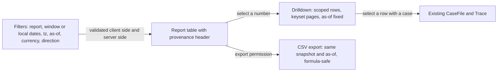

# AN01: financial analyst workspace design

Audience: Codex, as reviewer and later integrator, and the backend (Claude) and frontend (Cursor) implementers of the first analyst slice. This is the analyst-depth part of roadmap milestone G2 ([PROJECT_PLAN](../PROJECT_PLAN.md) §G2). It does not rename or renumber G4.

- **Status:** design draft for review. Nothing here is implemented, accepted or exposed.
- **Draft markers:** every route, capability, DTO, index and table below is a **draft requiring review**.
- **Base:** main `d8443a1`, which contains tested integration `495c7d3` and accepted plan `cee83f9`. The design does not depend on the unaccepted G3D-P4a branch.
- **Companion documents:**
  - [AN01-report-contract-draft.md](AN01-report-contract-draft.md): report IDs, filters, DTOs and money rules;
  - [AN01-acceptance-cases.md](AN01-acceptance-cases.md): the known-answer example and proposed checks.

## 1. What the analyst needs, and what the data can answer today

The product stays a synthetic fraud-review workbench with simulated actions. The analyst questions below come from the roadmap's "query synthetic financial data, reconcile totals, examine model errors and export a report". Each is checked against what the database actually stores at `d8443a1`. There is no warehouse, no curated view layer and no read-only reporting role yet.

| Question | Stored data that answers it | Supported now? |
| --- | --- | --- |
| How much money moved, per currency and direction, in a period? | `transactions.body.amount` (currency, minor_units, exponent), `body.direction`, `occurred_at`, `ingested_at`, scope columns | **Yes, as a new read-only query.** Amount and direction are in JSONB, not columns (§5) |
| Do my totals reconcile with the transactions I sent? | Same, with `external_id` unique per session | **Yes.** A count and per-currency integer totals, compared with the analyst's own expected file |
| How many transactions alerted, by day and currency? | `scoring_outcomes.alerted`, `.score`, `body.scoring_kind` / `score_semantics`; `alerts` | **Yes.** Rows ingested before migration 0002 have no outcome; they are reported as "score unknown", never as not alerted |
| What is my case workload? | `cases.state`, `created_at`, `revision`; `approvals`; `simulated_actions` | **Yes.** State counts at a point in time are partly approximate for history (§4) |
| Is the data healthy? | outcome presence, ingestion lag (`ingested_at − occurred_at`), alert↔case links | **Yes**, as invariant checks |
| Where is the model wrong? | `fraud_disclosures` (`is_fraud`, `disclosed_at`, `recorded_at`), operator-provisioned | **Not in the first release.** Labels are sparse, delayed and operator-supplied. Error rates need a labelled dataset with eligibility and cutoff provenance (§6) |
| Reversals, refunds, chargebacks, fees, FX? | None. A transaction has only `direction` debit/credit | **No.** No reversal link or fee field exists; the design never infers one |

**Smallest useful first release (AN01-S1):** three aggregate reports and one drilldown, read-only and scoped to the analyst's own session:
1. **Currency totals.** Per currency and direction: counts and integer minor-unit sums.
2. **Daily activity.** Per day (in the chosen timezone) and currency: transactions and alerts.
3. **Workload and data quality.** Case state counts, open-case age, outcome coverage, ingestion lag and link invariants.
4. **Drilldown.** A keyset-paginated row list behind any number, linking to the existing case file.
5. **CSV export** of these, under a separate, draft, audited capability.

**Deferred** (ranked backlog in §8): model-error slices, cohorts, saved queries, a curated-view reporting role, charts beyond simple accessible bars, and anything needing FX, reversal links or labels.

## 2. Principles

- **Curated queries only.** Each report is a fixed, reviewed SQL statement with validated parameters. There is no arbitrary or LLM-generated SQL, no owner-role query, and no write path. Generated SQL would not become trustworthy by passing a text filter (PROJECT_PLAN §G2).
- **Server-side scope.** Tenant and session come from the authenticated session, exactly as `list_cases` and `overview` do today. They are never a request parameter. Foreign data is indistinguishable from absent data.
- **Snapshot consistency.** Each report runs in one `REPEATABLE READ, READ ONLY` transaction, or as one statement. Every report also applies an **as-of** cutoff on `ingested_at`, so a paginated drilldown or an export does not shift while ingestion continues (§4).
- **Integer money per currency.** Sums are integers in minor units, never floats, and never added across currencies (§3). There is no FX conversion without separately specified dated rates; rates are not fetched and no vendor is introduced.
- **Observable, not true.** An alert, a score, an approval or a simulated hold is an observable workflow outcome. None of them is confirmed fraud. Scores are uncalibrated rankings (`score_semantics`), never probabilities.
- **Provenance on every answer.** Every response states the report ID and version, the scope label (the current session), the window, timezone and as-of, and the generation time. It also says it is synthetic data.

## 3. Money semantics

Stored fields per transaction: `amount.currency` (USD, INR, GBP or JPY), `amount.minor_units` (an integer > 0, at most 9,000,000,000,000), `amount.currency_exponent` (2, or 0 for JPY, enforced by the contract) and `direction` (debit or credit).

| Term | Definition (per currency) |
| --- | --- |
| debit total | Σ `minor_units` of debits |
| credit total | Σ `minor_units` of credits |
| gross | debit total + credit total |
| net outflow | debit total − credit total (signed; negative means more credit than debit) |
| count | number of stored transactions (never replay requests) |

- **Display.** Divide by 10^exponent only for display; arithmetic stays on integers. JPY has exponent 0.
- **Large sums.** A sum can exceed JavaScript's safe integer limit (2^53 − 1 ≈ 9.007 × 10^15). For example, 1,001 maximum-size rows sum to 9.009 × 10^15. Sums are therefore **decimal strings** in the DTO, while counts stay integers.
- **Cross-currency totals.** A count across currencies is allowed ("8 transactions"). A money total across currencies is never computed or displayed.
- **Unsupported terms.** "Reversal", "refund", "fee" and "net of chargebacks" have no stored basis, and the reports neither show nor approximate them.
- **Replays.** A replayed `POST /v1/transactions` (same `external_id` and body) returns `replayed: true` and stores nothing new. A conflicting one returns 409 `idempotency_conflict` and stores nothing. Aggregates count stored rows, so replays never inflate them. Replay *requests* are not recorded anywhere today, so a "replay count" report is not possible without new storage. It is not proposed.

## 4. Time semantics

- **Event time.** `occurred_at` (timestamptz, UTC) is the window and bucketing time. A window is half-open, `[from, to)`. `from` and `to` are RFC 3339 instants with an offset, or local dates plus a `tz`.
- **Availability.** `as_of` (default: the request's server time, which must be ≤ now) includes only rows with `ingested_at <= as_of`. It is also how a multi-page drilldown or export stays stable: the first page fixes `as_of` and the cursor carries it.
- **Timezone.**
  - `tz` is an IANA name that both Python `zoneinfo` and PostgreSQL accept; it is validated against both. The default is `UTC`.
  - It changes only how local dates map to instants and how day buckets are cut.
  - In zones with daylight saving, a local day is 23 or 25 hours long; buckets are labelled by local date, and the hour count is shown.
- **Range limit.** At most 92 days per request (a draft value), refused beyond that with `422 invalid_request`.
- **History of case states.** Cases store their current `state`, a `created_at` column, and `updated_at` inside the JSON body. There is no state-history table, only audit events. "Cases by state as of a past time" is therefore exact only for `as_of` ≈ now. For a past `as_of`, the workload report shows creations up to `as_of` and labels the state breakdown "current state". It does not reconstruct history from audit events in S1.

## 5. Data access and performance

- **Index gap.** Today's transaction index is `(tenant_id, session_id, account_id, occurred_at)`, which does not lead on `occurred_at` for a session-wide window. A draft migration would add `(tenant_id, session_id, occurred_at, id)`, which also serves the keyset drilldown order.
- **Amount fields.** Amount and direction are in JSONB. For S1, expression access (`(body->'amount'->>'minor_units')::bigint`) inside the curated SQL is acceptable at synthetic scale. A later draft could add generated columns. Either way it is a reviewed migration, never a runtime change.
- **Database identity.** Reports run as the existing least-privilege runtime role, which already has SELECT on every table. A dedicated read-only reporting role with curated views is the PROJECT_PLAN target. It is a later item (§8), because S1 adds no write path and keeps the session filter in reviewed server code.
- **Limits.**
  - Aggregates are bounded by construction: at most 92 days × 4 currencies × 2 directions.
  - The drilldown pages at ≤ 100 rows (the existing `MAX_PAGE_SIZE`).
  - Exports stop at 10,000 rows (a draft value), refused with `413 report_too_large` so the analyst narrows the filters.
  - A statement timeout bounds every query, reusing the existing database-wait style.

## 6. Labels, truth and model errors (deferred analysis, explicit rules)

- **What is stored.**
  - `fraud_disclosures` is the only label-like data. It is provisioned by the operator, per external_id, with `is_fraud`, `disclosed_at` (when it became known) and `recorded_at` (when this service stored it).
  - The simulator's ground truth and the frozen p1 test split are offline ML assets. They are **not** a dashboard source, and AN01 does not touch them.
  - Private agent-evaluation packets are not a dashboard source either.
- **Rule for any future error slice.** A transaction is *labelled at as-of* only if a disclosure exists with `recorded_at <= as_of` and `disclosed_at <= as_of`. Otherwise it is *unlabelled*, which is not negative.
- **What error analysis would need.** A labelled evaluation set with:
  - an eligibility rule (which transactions can be labelled);
  - a label cutoff (delayed labels per the G2 simulator);
  - a stated unit of review and threshold.

  The existing p1 model report (`GET /v1/model-results/p1`) remains the only model-performance source. It is an offline synthetic benchmark.
- **S1 therefore offers only label availability counts** (labelled fraud, labelled not fraud, unlabelled, at as-of). There are no rates, precision or recall, and nothing is presented as confirmed fraud.

## 7. UI flow (extension of the existing workbench)

The existing app (`web/src/ui`) has a sign-in, a queue (`Queue.tsx`), a case file (`CaseFile.tsx`), an analysis panel (`AnalysisPanel.tsx`), a trace panel, an ingest form and the model report (`ModelReport.tsx`). AN01-S1 adds a **Reports** view beside the queue, using the same API client and formatting helpers (`web/src/api/format.ts`). It adds no new framework or dependency.

**States, each with clear text:**

| State | Shown |
| --- | --- |
| Loading | a polite live-region "Loading report…"; the previous result stays visible but is marked stale |
| Empty | "No transactions in this window as of …" (not "0 USD", which would imply a currency) |
| Error | the typed error from the server (`invalid_request`, `report_too_large`), with the filter to change |
| Stale | an as-of older than a configurable age is labelled with its timestamp, plus a refresh action |
| Denied | `403 permission_denied` for exports without the capability; reports without `read_case` are not shown |

**Accessibility:** real tables with `<th scope>`, captions naming the window, as-of and currency, and money cells right-aligned with the currency code. The existing contrast patterns are kept (`Queue.contrast.test.tsx`). Any bar chart has a table equivalent. Nothing is conveyed by colour alone.

**Provenance header** on every report: synthetic data, scope (the current session), the window and tz, the as-of and the generation time. On alert reports it also states that scores are uncalibrated and alerts are not confirmed fraud.

**Export:**
- The CSV is generated server-side from the same snapshot.
- Text cells starting with `=`, `+`, `-`, `@`, a tab or a carriage return are prefixed with `'`; numbers and integer strings are not changed.
- It is UTF-8 with a header row that includes the provenance fields.
- Exports are private to the session. The proposed retention is none on the server; the response is streamed.
- **Audit:** today `audit_events.case_id` is required, so a report export cannot be audited without a schema decision. The options are a draft `report_exports` table (session, report ID, filters digest, as-of, row count, time) or a nullable case link. This is an **open question** for review.

## 8. Implementation split and ranked backlog

**Dependency order:**
1. Contract acceptance (the report contract draft, plus the open questions in §7 and the contract draft's §6).
2. **Backend (Claude-owned slice):**
   - the draft index migration;
   - the curated queries in a new service module;
   - the routes and capability check;
   - the known-answer fixture tests from [AN01-acceptance-cases.md](AN01-acceptance-cases.md).

   It must keep the existing `list_cases` and `overview` behaviour and frozen contracts v1, v1.1 and v1.2 unchanged. The new routes would go in a new contract version.
3. **Frontend (Cursor-owned slice):**
   - the Reports view, filters, tables and drilldown links;
   - CSV download;
   - unit tests;
   - browser tests against the real stack with the known-answer fixture.
4. Codex integration and full gates.

The backend and frontend can proceed in parallel after step 1, with disjoint owned paths (`src/sentinel/reports*` and its tests; `web/src/ui/Reports*` and `web/src/api/reports*`).

**Ranked backlog after S1:**
1. Label availability and a labelled evaluation-set specification (eligibility, cutoff, unit of review), then model-error slices on that set only.
2. A dedicated read-only reporting role and curated views (PROJECT_PLAN §G2), with a statement timeout and row limits enforced in the database.
3. Saved report definitions (filters only, no SQL), scoped to the session.
4. Temporal distributions (hour of day, ingestion lag histogram) and per-account drilldown.
5. Cohorts by account profile (home currency, account age at decision), only where profiles exist.
6. Dated FX rates as a separately specified, versioned input, if ever needed. Never fetched at runtime, and never mixed with S1 totals.

Unsupported until data exists: reversals, refunds, fees and chargebacks.
