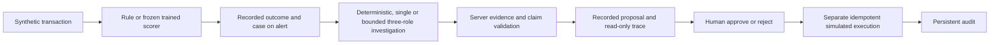

# Sentinel checkpoint: November 7, 2026

## Current next step: reporting prototype

AN01's corrected r3.2 design is accepted; R50–R52 close as design issues. Codex applied
the final stage-watchdog and pre-connect capacity-reservation corrections while preserving
Claude's `2db42ee` commit. The SQL/controller implementation and tiny real-database proofs
are now assigned. No full-size grid, production Reports route or live evaluation is assigned;
all performance values remain provisional and v1.3 is not frozen.
[Design review](../reviews/AN01-r31-2db42ee.md) ·
[Claude prototype assignment](../prompts/CLAUDE_AN01_M1_IMPLEMENTATION.md).

## Earlier AN01 review (superseded above)

Proposalb436c5e still needs R50–R52 corrections: UTC-edge zone-table coverage, a fully
specified/bounded report-query measurement plan, and honest connection versus SQL budget
semantics. Opt-in versioning, the unsigned cursor and a five-minute receipt-age nudge are
supported for revision. The app/tooling remains accepted; this is a new design gate.
[Review](../reviews/AN01-r3-b436c5e.md) ·
[Completed Claude revision prompt](../prompts/CLAUDE_AN01_R3_REVIEW_FIXES.md).
No report-query load run or production Reports implementation is assigned yet.

The corrected evaluator/benchmark/recorded-demo batch is accepted and locally integrated.
R46–R49 are closed. The tested integration is871e31d40e93306cfde6617e814c2cb78ae67c9e;
its later documentation publication has the same application/tooling bytes.

## What the project does

Sentinel is a synthetic fraud-investigation workbench. It records a rule or trained risk
score, creates a scoped case when the score triggers an alert, lets a bounded investigator examine stored evidence, and
shows the analyst a server-checked proposal and its trace. A human must approve and then
separately execute. Execution writes an auditable simulated outcome, never moves money.

FastAPI/Pydantic define typed HTTP contracts; PostgreSQL enforces persistence, revisions,
scope and append-only audit protection. React/TypeScript/Vite provide the analyst UI.
The trained scikit-learn baseline is artifact-pinned and its synthetic evaluation is
reproducible. The three-role coordinator bounds roles/tools/transitions and handles late
workers, unknown commit results and recovery. Models cannot authorize actions.

## What changed today

- P4a evaluation preparation: owned deterministic pilot roots/databases, operator/runtime
  separation, versioned records, scoped read-only export, bound partially blinded human
  sheets and offline scoring. Wrong recommendations stay counted. Partial/unknown answers
  stay explicit. This prepares a live pilot; it does not provide live quality results.
- PERF01: a bounded deterministic measurement tool and one-laptop report. The reported
  three-role capacity refusals expose the one-workflow-per-process limit honestly.
- DEMO01: a portable key-free recorded case replay showing evidence, roles, proposal,
  scripted human approval, exactly one simulated action and idempotent replay. Freshness
  checks actual generator/src content even without capture history.
- AN01: revised financial-reporting documentation is present as a draft. No Reports API,
  reporting capability, migration, export or UI has been implemented from it.

## Verified evidence

Independent review:167 focused tests and11 extra probes pass; replay Chromium31/31;
AN01 arithmetic34/34. A real local shallow clone validates the unchanged capture, detects
a changed source byte and returns clean after restoration. Exact integration gates on
Windows then unprivileged Ubuntu each pass810 tests plus the one allowed live-Claude
skip, all six strict commands, same-run811-case JUnit, HTTP/package and read-only ML.

The product UI/browser suites were not rerun because production src/web/contracts and
dependencies did not change. Earlier dated UI evidence remains distinct. All original
failures/captures, candidate branches and Cursor's seven saved edits remain preserved.
All new commits use PHANI465 <pgavara1@asu.edu> as sole author and committer, no trailers.

## What remains

1. **Live development evaluation:** separate written go-ahead, allowance/schedule and
   model/quota annotations before P4b. No live provider/auth/account call or final cases
   have run. Workflow elapsed's150 s evaluation gate remains unmeasured.
2. **Analytics design:** settle the six AN01 decisions before assigning backend/UI:
   zone-data pinning, capability/version compatibility, cursor integrity, measured query
   bounds, index strategy and report-age wording. Existing-app PERF numbers cannot prove
   proposed reporting SQL limits. Labels and audited CSV are later slices.
3. **External delivery:** real GitHub CI, Linux browser/macOS tests, hosting and BYOK need
   their own work/authorization. No external push, deployment or additional spending.
4. **Broader evidence:** synthetic scenarios and a small laptop sample do not establish
   real fraud detection, provider quality, calibrated probabilities or production scale.

Real-life analogues include a bank analyst reviewing an unusual-transfer alert, a payment
operations reviewer checking a proposed hold, and an auditor replaying why a case reached
its disposition. This project demonstrates those review/control patterns using synthetic
data and simulated actions; production financial integrations are future work.

[Re-review](../reviews/Batch-r2-10a65ee.md) ·
[Release evidence](../releases/Batch-r2-main-integration-2026-11-07.md) ·
[Current overview](AgentForge_Sentinel_Overview_and_Remaining_Work.md) ·
[Complete study guide (dated November2)](AgentForge_Sentinel_Complete_Project_Study_Guide_2026-11-02.md)
