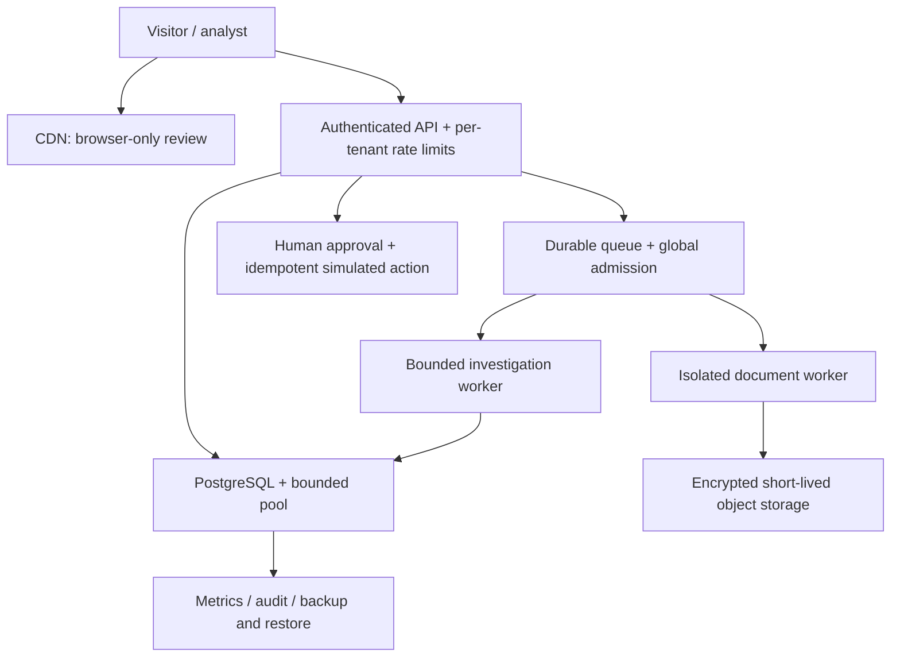

# Using Sentinel today and growing it responsibly

Updated November 15, 2026. Companion to the [README](../../README.md) and
[security review](../security/PROJECT-REVIEW-2026-11-15.md).
The stages below are recommendations, not authorization to deploy, spend or collect data.

## What the project is for

Sentinel combines two useful ideas: make financial discrepancies explainable from their
source, and make investigation actions controlled and auditable. A scoring model can rank
a transaction; it cannot determine human intent. A document can contain inconsistent
numbers without being fraudulent. Sentinel therefore presents evidence and uncertainty
and leaves consequential decisions to a person.

Its strongest present uses are a portfolio demonstration, a teaching tool for secure agent
workflows, and a local research platform for synthetic financial investigations. Broader
accounts-payable, audit-preparation and statement-review uses are plausible directions,
but require document coverage and customer controls beyond the current demo.

## A practical demonstration

| Time | Show | Explain |
| --- | --- | --- |
| First minute | [Purchasing sample](https://agentforge-sentinel.vercel.app/?sample=purchase#review), then Try the sample | One invoice is compared with its order, delivery and trusted vendor record. |
| Next minute | Open source excerpts for a price or quantity finding | The result is based on identifiable inputs and exact arithmetic, not an unsupported accusation. |
| Next minute | A normal control and an incomplete example from [Examples](https://agentforge-sentinel.vercel.app/examples.html) | Passing and inconclusive results are as important as flags. |
| Next two minutes | [Live workbench](https://agentforge-sentinel.vercel.app/workbench) or [recorded walkthrough](https://agentforge-sentinel.vercel.app/walkthrough.html) | Investigation, proposal, explicit approval, simulated execution and audit are separate steps. |
| Final minute | [Capabilities](https://agentforge-sentinel.vercel.app/capabilities.html) | Explain supported layouts and what cannot be concluded. |

For your own files, first use public/synthetic documents. Select related PDFs, XLSX or
DOCX together, verify the extracted fields, and independently choose any trusted vendor
baseline. Keep currencies separate. The browser checks do not confirm vendor identity,
bank ownership, digital signatures, visual tampering or malicious intent. Do not use a
document's own claimed bank details as independent confirmation of those same details.

Use the static local server in the README for browser-only review. Use the full local stack
for API experiments and synthetic casework. Configure the local worker only when you need
its CSV/XLSX/PDF extraction path; it is not required for the public browser reviewer.

## What makes the project useful

- **Traceable evidence:** page/line, sheet/cell or Word block links let someone inspect a claim.
- **Cross-document checks:** a correct-looking invoice may disagree with an order, delivery,
  payment history or trusted remittance baseline.
- **Explicit uncertainty:** unrecognized, missing or contradictory inputs are not converted
  into reassuring zeroes or a clean bill of health.
- **Human control:** model output never substitutes for approval, tenant identity or permissions.
- **Engineering evidence:** exact artifacts, frozen contracts, refusal tests and recovery
  behavior make the project more defensible than a single chat prompt.

These are implemented design strengths, not a claim that no other product has them.

## Recommended sequence

| Stage | Work | Exit evidence |
| --- | --- | --- |
| 1. Harden the demo | Dependency fixes, anti-framing and response headers, route limits, release manifest, secret/dependency checks | Relevant security findings closed with negative tests; staging and live read-only verification; verified rollback artifact |
| 2. Validate usefulness | A permitted corpus of different statement/invoice layouts, normal controls, OCR as a separate opt-in experiment, missing-field explanations | Field-level extraction metrics and finding precision/recall on a held-out labeled set; false positives and abstentions reported |
| 3. Small private pilot | Named user authentication, tenant isolation, consent, retention/deletion, sandboxed parser, support and incident procedures | Cross-tenant tests, actual deletion checks, restore drill, access review and explicit data-use agreement |
| 4. Measured scaling | Shared job admission, bounded queue, durable worker recovery, pooled DB access and measured indexes | Concurrent-client tests, p95 latency, refusal rates, memory/storage bounds and recovery tests at an agreed target |
| 5. Advanced capabilities | Better matching, document sets, optional AI explanation, analyst feedback, qualified Reports | Per-feature evaluation; citations and human approval remain enforced; budgets and provenance are visible |

Avoid raising limits simply because the laptop demo passes. The AN01-M1 tiny timing controls
were **not demonstrated**, and its full-size grid has not qualified the provisional
200,000-row/5,000-ms report limits. The [PERF01 laptop report](../benchmarks/PERF01-local-capacity.md)
records refusals at higher investigation concurrency; it is not a Vercel capacity estimate.

## A scaling architecture to consider later

This is a future design, not the deployed architecture. Browser-only review is inexpensive
to distribute because parsing uses the visitor's device; qualify low-memory devices and
browser compatibility rather than only server throughput. API and database work require
bounded pools, timeouts, pagination and tenant fairness. File bytes belong in controlled
object storage if server processing is added, with quotas and deletion policy. A queue
must preserve ownership and idempotency across retries, rather than retrying ambiguous
financial outcomes automatically.

Start with a small measured deployment. Do not introduce Kubernetes or many microservices
without a demonstrated isolation, operational or throughput need. Current free allowances
and local subscriptions are not a production capacity or model-spending plan.

## Metrics that explain results

| Metric | Definition | Interpretation |
| --- | --- | --- |
| Extraction coverage | Required fields extracted with valid provenance / required fields | Describe the denominator; missing fields remain unknown. |
| Field accuracy | Correct extracted fields / evaluated fields in a labeled corpus | Requires reference labels; not computed from the parser's confidence alone. |
| Reconciliation difference | Expected closing amount minus printed closing amount, using the check's documented sign convention | Show currency, formula and both source amounts; do not combine currencies. |
| Finding precision | Correct flags / all reviewed flags | Measure false alarms; zero reviewed flags is n/a. |
| Finding recall | Correctly found labeled discrepancies / all labeled discrepancies | Requires labels including misses; not available from flagged cases alone. |
| Inconclusive rate | Inconclusive eligible checks / eligible checks | High values can reveal missing inputs or layout gaps; do not hide them. |
| Review utility | Time to a verified decision and human rating of evidence usefulness | A paired, controlled study is needed for a time-saving claim. |
| Service health | p50/p95 request latency, success/refusal/error/unknown rates, queue age | Include refused requests; successful-only latency can conceal overload. |
| Agent reliability | Supported claims / checkable claims; attempts, failures and unknown usage | Separate automated judges from blinded human assessment. |
| Resource use | Storage per session, retained bytes, active workers, model reservations | These are operational measurements, not inferred costs or global quotas. |

For the ML scorer, retain average precision/PR curves, recall at an alert budget,
false-positive rates, calibration and per-slice analysis. Publish split, label availability,
dataset provenance and uncertainty with every result. Avoid a single generic "fraud score"
for documents that implies a calibrated probability.

## Features worth prioritizing

1. **A result summary with reason and next step:** what matched, what differs, what is missing,
   and what evidence a reviewer should obtain. Preserve one-click source navigation.
2. **An explicit document-set checklist:** invoice, order, delivery and payment. Explain why
   a missing item blocks a comparison before the user mistakes it for a passed check.
3. **A private export:** a deliberate download containing findings, citations, check versions
   and limitations, with safe spreadsheet/text escaping. Do not export hidden document data.
4. **Verified corrections:** let users correct an extracted field with an audit trail; mark
   edited values and recompute. Never silently replace the source extraction.
5. **Broader input coverage:** measured layout adapters and then OCR, with extraction confidence
   and source coordinates. Keep authenticity detection a separate research claim.

Keep usability work practical: keyboard-only completion, visible errors, responsive source
panes, chart tables, meaningful empty states, and no overloaded ten-step first screen.

## Routine maintenance

**Each release:** review the diff, scan the built artifact and dependency sets, run relevant
tests, record the exact source, exercise staging, retain a rollback and verify the deployed
version. Keep application, worker and browser tests distinct.

**Regularly:** review upstream advisories, quota usage, errors, session/document retention,
disk space, backup restorability and model/data drift. Revisit date-based dependency holds.

**Before private customer data:** agree on permitted use, access, retention, deletion and
incident response; verify actual cloud controls and required obligations. Do not claim
SOC 2, PCI DSS, GDPR compliance or fraud-loss prevention from engineering tests alone.

## Completed and open

**Implemented:** synthetic ingestion/scoring, scoped casework, human approval and simulated
execution, investigation traces, local worker/API/UI, public browser insights, examples,
recorded walkthrough, hosted synthetic workbench, constrained project assistant, evaluation
tooling and the AN01-M1 measurement prototype.

**Open:** security remediation from this review, hosted CI qualification, broader browser
coverage, real-document quality evaluation, live-agent comparisons, qualified reporting
limits and Reports UI, OCR, production identity/tenancy, isolated customer uploads,
retention automation and measured deployment-wide capacity. An implemented demo is not
an enterprise-ready service, and those remaining items are not equally necessary for a portfolio.
