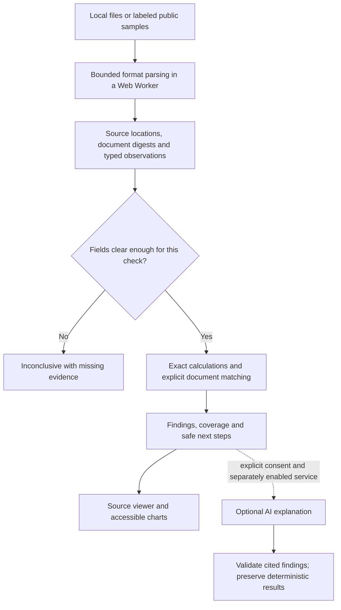

# Sentinel document insights: architecture and delivery plan

Date: November 15, 2026. Application baseline: `4bff7e12ca7d6eeaeca5061531d9011902038513`.
Owner: PHANI465. Implementation assistant for the remaining work: GPT-6.1 Sol, High effort.
This plan separates implemented foundation, authorized implementation, and future options.
It is not a claim that the public website already supports the proposed detections.

## 1. Owner choices and the immediate goal

The owner selected both single-document explanation and comparisons, beginning with
invoices, statements and payment records. Publish clearly labeled synthetic fraud-review
scenarios and official public financial reports. Codex owns the initial evidence/security
design and critical foundation; Sol implements the remaining slices, using High effort.

The owner delegated the privacy choice and prefers using existing subscriptions where
possible. Selected policy: useful deterministic analysis stays entirely in the browser.
Optional remote AI explanation requires an explicit preview/consent action for each
current review. It is disabled until a separate budget and operational review are complete.
No new provider call, purchase, subscription relay or public upload service is enabled here.
The existing project-only IAF service and its limits remain unchanged.

## 2. What works today, and what does not

The public site reads text PDFs, XLSX and DOCX locally. It uses label/pattern matching,
recognized invoice arithmetic, payment-instruction signals, limited workbook summaries,
and a Treasury Table 2 adapter. The local DOC01 worker/API and hosted synthetic casework
are separate products within the repository; neither is silently used by this public reader.
The p1 transaction model's test results do not establish document-fraud accuracy.

Read-only baseline probes found:

- The incorrect row `4 x USD 120 = USD 680` is flagged with a recognized header, but
  missed with the equivalent `Units / Unit Cost / Extended Amount` header.
- A statement with opening 1,000, credits 500, debits 200 and closing 900 produced
  no balance warning. The calculated closing is 1,300; printed minus calculated is -400.
- Current payment/address flags sometimes report what the document says, rather than
  compare independent records. Wording must preserve that distinction.
- IAF retrieves curated project/author passages. Its model selects a passage; it does
  not inspect uploads and is not a general financial-document assistant.

## 3. Pipeline and boundaries

Each new review gets an unpredictable browser-local review ID. Hash bytes with Web Crypto
before adopting results. Document IDs are generated locally, never paths or filenames.
Bind every asynchronous result to the review ID, file digest, configuration revision and
request generation. Clear old private content on replacement, reset and session changes.
Aborting work is useful; identity/generation checks determine whether its result can apply.
Revoke object URLs and terminate owned parser workers when a review ends.

No document content, filenames, account numbers or extracted text enters URLs, analytics,
logs, error reporting, browser persistent storage or IAF's project library. Use textContent
or framework text nodes. Do not render model/document HTML, execute formulas/macros,
follow embedded links, load remote Office relationships or let a document call tools.
No service-worker document caching. Test outgoing requests, not just UI privacy copy.

Preserve existing per-file 10,000,000-byte and 40-page PDF limits. The new packet boundary
has provisional implementation bounds of 10 documents, 20,000,000 aggregate input bytes,
2,000 summary facts and 1,200 UTF-16 code units per excerpt. These are limits, not throughput
claims. Preserve current expanded ZIP/cell/sheet/character bounds. Check aggregate limits
before reads and before decompression; streamed parsing must enforce actual output bounds.
Do not raise limits to make a sample fit. OCR is a separately measured later feature.

## 4. Implemented foundation in this branch

`public_site/static/document-evidence.mjs` is a browser-compatible dependency-free module.
It is NOT wired into the public UI yet and adds no HTTP route or provider integration.

- `createEvidenceReview({reviewId, documents, facts})` validates and freezes a review.
- Documents have generated `id`, lowercase SHA-256, `format` and `bytes`.
- Initial facts are ONLY four statement summary fields: `opening_balance`, `total_credits`,
  `total_debits`, `closing_balance`. They carry fact/document/statement IDs, currency,
  canonical decimal `amount` (or null), certainty, location and an excerpt.
- Locations are PDF `{page,line}`, XLSX `{sheet,row,column}`, DOCX `{block}`.
  These refer to parser-defined source units, not a promise of pixel-level highlights.
- Certainty is `extracted`, `user_confirmed` or `uncertain`. Confirmation is an observation
  correction by a user, not authentication or proof the source is truthful.
- Money uses integer minor units via BigInt. Unsupported currencies, ambiguous separators,
  exponent notation and excess precision are rejected. Never infer USD from `$` alone.
- `reconcileStatement(review,{documentId,statementId,currency})` compares the four printed
  summary fields within one document/statement/currency. It has zero hidden tolerance.
- Missing fields, uncertain values, duplicate candidate fields and negative aggregate
  credit/debit magnitudes produce `inconclusive`, never a false pass.
- Results contain rule/version, review/scope identity, evidence IDs, a fixed reason code,
  and exact calculated/printed/difference strings. No raw source is copied into errors.

Adapters remain responsible for correct extraction, computing the actual byte digest,
assigning account/period-specific statement IDs, resolving layout/currency, and validating
source coordinates against actual parsed content. The boundary checks shape and references;
it is not a signature verifier, server authorization boundary or proof of correct parsing.
Multiple legitimate summaries require separate scopes or an explicit selection, not silent
first-match wins. A statement-summary pass does not establish complete transaction coverage.

Sol must preserve this version's meanings. Invoice quantities, transaction rows and packet
relationships require their own typed schema/version; do not overload summary fields or
convert arbitrary OCR/model strings straight into trusted observations. Extend shared
money utilities with tests if justified; do not loosen existing validation.

## 5. Detection catalog and evidence requirements

Statuses on the public capability page: **Available**, **Limited**, **Planned**, **Not
supported**. A feature becomes Available only after its actual file-to-browser check passes.
Per-review outcomes: **passed**, **flagged**, **inconclusive**, **not applicable**, **not run**.
The new summary engine emits the first three; the UI/registry must account for the others.

| ID | Check / insight | Evidence and interpretation | Initial delivery |
| --- | --- | --- | --- |
| D01 | Line, subtotal, tax and payable math | Typed quantities/prices, adjustments and currency; preserve rounding policy and discounts | Extend current limited invoice checks |
| D02 | Statement summary reconciliation | Four printed summary fields for the same account/period/currency | Foundation implemented; extraction/UI next |
| D03 | Running balance and row reconciliation | Complete supported rows with ordering, dates and starting balance; exclude duplicated page headers | Sol after D02 |
| D04 | Exact duplicate invoice candidate | Stable vendor ID, invoice number, currency; distinguish a second copy from a second payment | Packet phase |
| D05 | Possible near-duplicate invoice | Explicit similarity evidence, matched dates/items/vendor and documented thresholds | Later packet extension; not a fraud verdict |
| D06 | Invoice versus purchase order | Match line identifiers, unit, quantity, currency, price and approved changes | Packet phase |
| D07 | Invoice versus receipt/delivery | Match delivery IDs and quantities; distinguish partial deliveries and installments | Packet phase |
| D08 | Invoice versus payments/credit notes | Matched references/currency, partial payments, refunds and reversals | Packet phase |
| D09 | Changed remittance details | Compare to a user-designated trusted baseline; otherwise only report a stated change | Packet phase |
| D10 | Possible approval splitting | User-supplied policy, explicit related group and time window; show grouping and limits | Packet phase; never infer an AML/legal threshold |
| D11 | Financial summary and trends | Same currency, period, units and accounting basis; report missing history | Incremental type-specific adapters |
| D12 | Document consistency | Conflicting identifiers/dates/totals within supplied records | Signals only; not digital-forgery certification |

No claim of authenticating a bank account, detecting all forged PDFs, proving criminal
intent, identifying stolen identities, sanctions screening, or real money movement.
Vendor/employee overlap needs trusted master data; a note saying they match is not a match
the system independently established. A routing checksum is only a format check.

## 6. Financial metrics and readable findings

Every finding needs: plain-language observation, check scope, evidence IDs, reproducible
calculation/comparison, limitation and a reasonable verification step. Separate observed
facts, user-entered assumptions and proposed interpretations. Never call flag counts a
fraud probability. Never sum overlapping discrepancy amounts as money lost.

| Document | Metrics | Guardrails |
| --- | --- | --- |
| Invoice | Calculated/printed totals, variance, matched/unmatched line counts | Separate currencies; adjustments and rounding explicit |
| Statement | Inflows, outflows, net movement, opening/closing reconciliation | Distinguish printed summary from verified row totals |
| Payments | Matched, unmatched, partial, reversed payments and overpayments | Reference/period/currency checks; duplicate-copy controls |
| Financial report | Revenue/expense changes, supported margins or budget coverage | Comparable periods/units/basis only; zero denominator = unavailable |
| Every type | Supported rows / observed rows, completed checks / applicable checks | Unknown denominator stays unknown; not run is not passed |

Severity is a documented review-priority rule, distinct from extraction certainty and
fraud probability. Document age, weekend timing and round numbers alone must not create
high-severity fraud allegations. Benford tests and generic anomaly scores are deferred
until a suitable dataset and measured false-positive rate exist.

## 7. Product and design brief

Navigation: Review documents / What we check / Examples / How Sentinel works / Ask IAF.
Keep the synthetic casework demo distinct from public document review. Explain local-only,
hosted synthetic and proposed features explicitly. Use the existing visual system first;
avoid a framework migration for a static page redesign.

The review journey is: choose documents, confirm the extracted fields, read findings,
inspect source evidence, choose next steps. Desktop has findings alongside a source panel;
mobile uses accessible tabs. Show important findings first, then metrics and coverage, then
technical provenance. Provide loading, cancel, failure, partial and unsupported states.
Keep normal documents useful: explain amounts, periods and balances even with no flags.

Use the original arithmetic example as a beginner card, not the lead value proposition.
Lead with a synthetic three-document example: invoice 200 units at USD 120 = 24,000;
purchase order 200 at USD 100 = 20,000; delivery 150 units. Show the price and quantity
differences separately. Do not sum overlapping differences into an invented loss figure.
Only label the interactive scenario available once packet checks actually run.

Charts: printed versus calculated bars, statement inflow/outflow waterfall only with
known inputs, dated balance line only with reliable dates, matched versus unmatched counts,
and a small evidence relationship diagram. Every chart needs a text summary and data table;
color is not the only signal. No 3-D charts, decorative risk gauges or graph clutter.
Test keyboard, focus, screen-reader names, 200% zoom and 360/390/768/1440-pixel layouts.

## 8. Sample and evaluation plan

Publish sample cards with type, difficulty, synthetic/official provenance, supported checks,
limits, file size/page count, download and Run example. Expected results are separately
available for learning, never fed into parsers or detectors. No real company is falsely
accused. Use invented entities and non-operational payment identifiers in synthetic files.

Minimum sample families (each has a normal paired control):

1. Multi-page invoice with discounts, shipping, tax, and one wrong line/total.
2. Statement with a balance discrepancy, a matched reversal and a legitimate zero balance.
3. XLSX ledger with repeated headers, formulas, mixed currencies and missing values.
4. DOCX invoice with tables and changed remittance instructions; trusted prior record.
5. Duplicate-invoice packet versus a legitimate repeated copy and recurring invoice.
6. Purchase order/invoice/delivery packet with partial deliveries and approved changes.
7. Payment reconciliation packet with installments, a credit note and a duplicate candidate.
8. Explicit-policy splitting scenario versus unrelated same-value purchases.
9. Ambiguous multi-column/locale/scanned pages that correctly abstain.
10. Existing official Treasury reports with known Table 2 values; later official financial
    report excerpts only after source/reuse/page-limit verification.

Prefer 4-12 page synthetic packets and multi-sheet workbooks over hundreds of filler pages.
Register source URL, retrieval date, license/reuse decision, original and served hashes,
transformations/page mapping and human-checked anchors. Public availability alone does not
authorize redistribution. Label any excerpt as an excerpt, never as the complete original.
For official reports, use the publisher's machine-readable data as an independent oracle
where available, checking period and rounding. Do not download private customer documents.

Evaluation must exercise actual file bytes -> parser -> detector -> UI, not only fabricated
JSON. Use development layouts and separately held-out layouts. No filename/label/annotation
shortcuts. Capture field accuracy, evidence-location correctness, per-detector precision and
recall on labelled cases, abstention/coverage, legitimate-control false positives, latency,
memory and network behavior. Include denominator and dataset/version for every metric.
An agent may propose labels or judge clarity; independent manual/source checks establish
the numeric oracle. Do not label agent-only scores human evaluation or population accuracy.

## 9. Optional AI design and subscription decision

ChatGPT Plus and Claude Pro are not ordinary hosted API credits. OpenAI documents eligible
participating-tool allowance sharing, but Sentinel integration/eligibility has not been
established. Never proxy the owner's consumer session, CLI authentication or subscription
cookies for anonymous website visitors. Personal manual use in the subscribed app is a
separate option: a user may explicitly export selected findings and paste them themselves.
No automatic send or prefilled third-party URL containing financial content.

Future server-side AI mode is an optional explanation of selected evidence, not a new
authority for amounts, fraud labels, account identity or actions. Implement only after a
reviewed endpoint contract, provider/data policy and owner-funded cap or verified visitor
allowance are decided. Until then feature disabled; no placeholder button implying it works.

Required before activation:

- A preview of exactly what leaves the browser, consent tied to document/review/config
  identities, minimum excerpts, masked identifiers, no raw files by default. Changing a
  review invalidates consent. Masking is not a guarantee of anonymization.
- Distinct server-side credentials and quota policy; never reuse IAF's allowance silently.
  Server-enforced request/token/daily/concurrency limits and durable reservations across
  instances. State maximum funded spend and failure behavior; no automatic paid fallback.
- Origin checks plus appropriate auth/abuse controls, body limits before allocation,
  timeouts, cancellation accounting and safe error codes. CORS alone is not authorization.
- Treat all visitor assertions as untrusted: recompute supported arithmetic server-side
  before calling it verified, or explicitly label browser assertions as user-supplied.
- Strict output schema; valid evidence IDs are necessary but do not prove factual support.
  Keep numeric facts deterministic. Prefer model selection of approved explanation templates
  initially; unconstrained prose needs grounding evaluation and an explicit generated label.
- No browsing/tools/executable links from document content. Instructions in documents stay
  inert. Refusals/provider failures preserve the local report. No source-body logging.
- Provider retention disclosure. `store:false` alone is not zero retention; OpenAI documents
  abuse-monitoring logs and separate controls. Do not promise deletion at the provider unless
  the actual configuration supports that promise.

## 10. Delivery slices and responsibilities

| Slice | Owner | Concrete completion |
| --- | --- | --- |
| F0 | Codex, this branch | Exact money/evidence/statement boundary, tests, architecture, threat model and dispatch |
| S1 | Sol High | Typed extraction adapters, worker lifecycle, statement UI integration and real-file regressions |
| S2 | Sol High | Explainable result layout, capability catalog and broader single-document invoice/statement checks |
| S3 | Sol High | Complex sample library, normal controls, deterministic generators/oracles and source provenance |
| S4 | Sol High | Local multi-file matching, comparison rules and relationship evidence; versioned typed packet model |
| S5 | Sol High | Full user-journey polish, accessibility, source panel/charts, docs and final validation |
| A1 | Later reviewed assignment | Optional remote AI endpoint, consent, measured quality, approved funding and activation |

S1 through S5 can proceed sequentially without asking for permission after every slice.
Freeze interfaces and write checks before consumers rely on them. No parallel agents are
required for this dispatch. If later authorized, only independent files/worktrees may be
parallelized; database/browser/full gate jobs remain sequential.

After S5, Codex reviews extraction ambiguity, financial semantics, privacy, failed evidence
and final integration. Do not call this foundation an independent certification of its own
implementation. Deployment is a separate release with local acceptance and live verification.

## 11. Broader project backlog, kept separate from this release

- Analyst case search/filtering and a clearer evidence timeline.
- Account-profile comparisons using licensed research data, temporal splits and honest
  synthetic versus real-data evaluation; keep p1 frozen.
- AN01 Reports production design after timing/disk limits are resolved, not by promoting
  the benchmark prototype's provisional caps.
- Hosted access controls, retention/deletion, upload quotas, monitoring and stronger parser
  isolation before private-customer or multi-user document hosting.
- Real CI and Linux browser execution; restore disk headroom before heavy work.
- OCR/forgery-signal research, with accuracy and resource measurements before public claims.

## 12. Research sources and their limited use

Checked November 15, 2026. These inform design; they do not validate Sentinel's detectors.

- [ACFE analytics tests](https://www.acfe.com/fraud-resources/fraud-risk-tools---coso/anti-fraud-data-analytics-tests): duplicate and purchasing/payment review ideas.
- [FBI business email compromise](https://www.fbi.gov/how-we-can-help-you/common-frauds-and-scams/business-email-compromise): independently verify payment-detail changes.
- [SEC financial statement guide](https://www.sec.gov/about/reports-publications/beginners-guide-financial-statements): keep statement types and accounting context distinct.
- [Treasury MTS data](https://fiscaldata.treasury.gov/datasets/monthly-treasury-statement/summary-of-receipts-outlays-and-the-deficit-surplus-of-the-u-s-government/): official sample/reference candidate.
- [W3C complex images](https://www.w3.org/WAI/tutorials/images/complex/) and [tables](https://www.w3.org/WAI/tutorials/tables/): accessible chart/table explanations.
- [NIST generative AI profile](https://nvlpubs.nist.gov/nistpubs/ai/NIST.AI.600-1.pdf): grounding and evaluation risks.
- [ChatGPT Plus](https://help.openai.com/en/articles/6950777-what-is-chatgpt-plus): API billing is separate; eligible participating-tool allowance sharing has conditions.
- [Claude Pro](https://support.claude.com/en/articles/8325606-what-is-the-pro-plan): Pro does not include Console API usage.
- [OpenAI data controls](https://developers.openai.com/api/docs/guides/your-data): distinguish stored responses from other retention controls.

See [Sol dispatch](../prompts/SOL_DOCUMENT_INSIGHTS.md) and
[foundation handoff](../handoff/CODEX-document-insights-foundation.md) for execution state.
